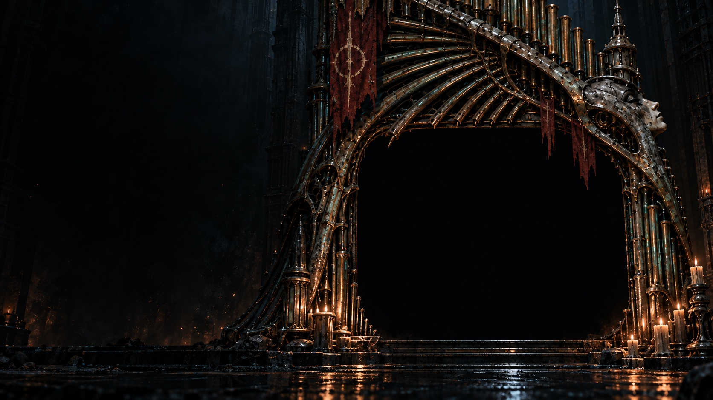

# NULL CHOIR

Original single-player cosmic-horror FPS for Apple Silicon Macs. Godot draws Blender-built pixel sprites in a 3D containment cathedral; eight selected Suno instrumentals play offline through the native Music bus. Original MIDI compositions and their synth remain preserved.

## Playtest download

[Enter the NULL CHOIR download page](https://null-choir.jaymoney.chatgpt.site).

[](https://null-choir.jaymoney.chatgpt.site)

[Download Alpha 4 for Apple Silicon Macs](https://github.com/ihearttokyo/null-choir/releases/download/v0.2.3-alpha.4/NULL-CHOIR-0.2.3-alpha.4-Apple-Silicon.zip). **Alpha 4 — unfinished incremental playtest, not completion of the full Alpha 4 scope or a final release.** Requires macOS 14 or newer. This archive is Developer ID-signed, Apple-notarized and stapled; keep system security protections enabled. [Alpha 4 changes and known limitations](https://github.com/ihearttokyo/null-choir/releases/tag/v0.2.3-alpha.4).

### What changed between playtests

- **Alpha 2:** title music and the nine-track Resonance Chamber Sound test. The revised topography across all eight campaign maps was already included.
- **Alpha 3:** physics-step encounter activation and an unnecessary terrain-height lookup removed, with regression coverage. No measured FPS improvement is claimed.
- **Alpha 4:** Pause/ending descent-progress screen with eight-depth status, Blood/Ivory objectives and earned record access. This is a text/status map, not the planned illustrated, semi-animated descent map.

All three retain the same revised eight-map layouts. Alpha 3/4 do not add new levels, weapons or bosses. These releases use separate release-source branches; publishing them did not merge the outstanding gameplay PRs into this default branch.

**Still unfinished:** the Heart Ivory/Return automated route exceeds its original time budget; full earned campaign completion with both seal orders/all difficulties, sustained performance, physical mouse/gamepad checks, listening acceptance, and the integrated illustrated descent map/intro artwork remain unverified or incomplete. Package checks and notarization do not establish those requirements.

[Alpha 3 release and rollback](https://github.com/ihearttokyo/null-choir/releases/tag/v0.2.3-alpha.3) · [Alpha 2 release and rollback](https://github.com/ihearttokyo/null-choir/releases/tag/v0.2.3-alpha.2)

[LICENSE](LICENSE) governs the original project and soundtrack. Official unmodified binary archives may be shared free of charge for noncommercial use; source and assets are not open source or public domain. Third-party notices retain their own terms.

## Development status

The current source registers all eight maps, with two native traversal loops and seven distinct religious-inspired set pieces per level. All 56 pieces have editable Blender sources. Six weapons and eight enemy roles, including two manifested bosses, pass native behavior checks; the boss encounters block descent until their persisted defeat. The HUD now includes a reference-derived restraint instrument with real HP and phase feedback. The current soundtrack maps one selected Suno take to each level; the original eight MIDI scores remain preserved. Four image-derived overhead modules now add growth vessels, bone sorting, cosmic fractures and arterial ribs across the late loop chambers.

Earlier development previews remain available; final campaign acceptance remains unfinished. Inversion now has recessed cosmic cavities, fractured violet incisions and visible sparse stars. Two existing examination spotlights reveal the Nursery organism and the Heart's tooth-lined throat. Independent focused pixel reviews and correctness/Ponytail reviews pass. Strict inventory covers 92 editable art assets and 93 exports. Both changed maps pass source and boundary checks; all 24 native late-map difficulty/seal-order cases pass.

The earlier v0.2.2-suno.1 ZIP passed all eight native packed scenes/art/live MIDI/weapons/actors, strict ad-hoc signing, system-only dependencies and isolated user data. The v0.2.2-suno.2 archive preserves that game payload and additionally passes Developer ID, Apple notarization, stapled-ticket, Gatekeeper and packed-app checks. Actual standalone title/Continue, stock Escape pause, live Heart world, staged death/checkpoint restoration, save/title and normal Quit pass. Thirty M4/Metal source-candidate stress samples measure 105.81–120.77 FPS with warm scene construction at most 417.10 ms. These are source diagnostics, not a release-binary matrix or full playthrough.

The published 0.2.1 app missed the initial three-second title-frame target. Current source builds bake native Metal libraries into the development app; controlled launch comparisons show an improvement, with measurement limits recorded in [CHECKPOINT.md](CHECKPOINT.md). This does not certify reboot-cold or normal input-ready launch. Held physical controls, heard musical quality and full played pacing remain open. [DESIGN.md](DESIGN.md) owns requirements.

Source-native checks preserve captured actor damage and summoned companions through Continue and checkpoint recovery on all three difficulties; entry restart restores the original entry actor state. Corrected packed-app validation, full-campaign combat, listening and physical controls remain unfinished.

## Run and build

[Mac development builds](https://github.com/ihearttokyo/null-choir/releases) retain the published 0.2.1, 0.2.0 and 0.1.3 previews as rollback evidence. The current builder produces a native Metal-baked 0.2.2 development app for Apple Silicon Macs running macOS 14 or newer. [Source integration](https://github.com/ihearttokyo/null-choir/pull/1) tracks the reviewed eight-level development project; merging source does not certify a corrected standalone app.

Open `game/project.godot` in Godot 4.7.2, or run:

```sh
godot --path game
```

WASD moves, mouse looks, left click fires, E interacts, Q/Tab cycles weapons, 1–6 selects acquired weapons, and Escape pauses. Gamepad defaults use left/right sticks, right trigger, A and shoulder buttons. Settings includes sensitivity, separate music/effects gains, optional motion effects and native control rebinding. Save-and-title/quit preserve the session if saving fails and offer an explicit discard choice.

With Python 3.11 or newer, matching Godot 4.7.2 Mac export templates, Xcode and Apple's Metal Toolchain installed:

```sh
python3 tests/test_build_deadline.py
python3 tests/test_build_source.py --allow-window
python3 tests/test_macos.py
```

Shader baking requires a native macOS GPU export; headless export cannot bake these libraries. The build and native source-preservation test refuse by default before creating outputs or launching Godot. Use `--allow-window` only when opening and activating a Godot graphics window is intended; license generation and import remain headless. The builder copies the game into a temporary local folder, imports it separately, exports without rewriting the editable project, thins the official engine to arm64, applies a local ad-hoc signature, verifies it, and writes `builds/macos/NULL CHOIR-arm64.zip`. It leaves installed templates and global configuration unchanged. This is a development app, without Developer ID signing or notarization. Extract the ZIP with Finder or `ditto`; cloud-folder metadata may invalidate signatures on copied app directories.

Build validation retains a 300-second deadline and terminates its isolated process group on timeout. The deadline fixture verifies that no live owned descendant survives.

`tests/test_macos.py` runs the exported binary's `--verify-export` path with a temporary isolated HOME. It checks all eight packed scenes, art, selected recorded audio and retained MIDI sources/soundbank, late weapons/actors/bosses, native Metal cache files, macOS 14 target metadata and the original start/fire/pause/checkpoint assertions. It does not prove GUI usability, audio timbre, frame rate or campaign completion.

## Source and checks

[ARCHITECTURE.md](ARCHITECTURE.md) describes module ownership. [Blender pipeline](docs/ART.md) covers regeneration and editable scenes; [audio playback](docs/AUDIO.md) records dependency pins, patches, licenses and runtime API.

```sh
python3 tools/check_game.py tests/test_scenery.gd tests/test_campaign.gd tests/test_level.gd tests/test_foundry.gd tests/test_processional.gd tests/test_processional_flow.gd tests/test_combat_expansion.gd tests/test_level_transition.gd tests/test_player.gd tests/test_gameplay.gd tests/test_enemy.gd tests/test_interaction.gd tests/test_autoaim.gd tests/test_completion.gd tests/test_sprite_direction.gd tests/test_save_failure.gd tests/test_music_game.gd tests/test_preferences.gd tests/test_controls.gd
python3 tools/check_game.py tests/test_metal_cache.gd
python3 tools/check_game.py --timeout 180 tests/test_save_placement.gd
python3 tools/check_game.py --timeout 360 tests/test_late_roles.gd
python3 tests/test_music.py
python3 tests/test_art.py
blender -b -t 4 --python-exit-code 1 --python tests/test_art_pose.py
godot --headless --audio-driver CoreAudio --fixed-fps 60 --path game --quit-after 20000 --script tests/test_traversal.gd -- --level=1
```

These use actual native gameplay/assets; headless input is simulated. A PASS marker and clean exit are required. The runner enforces a finite wall-clock deadline. The full late-role fixture needs about three minutes on the measured M4 host. MIDI assertions and native CoreAudio capture are separate from listening and GUI review.

Original code, compositions and art remain project-owned. Third-party notices are retained in `licenses/audio/`, packaged audio/add-on notices and `game/licenses/Godot-Third-Party.txt`. GeneralUser GS permits software redistribution but qualifies historical sample origins; that qualification is retained with the redistributed bank. No copied Doom maps, sprites or songs are included.
