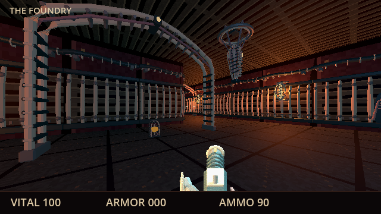
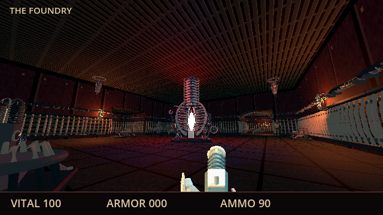
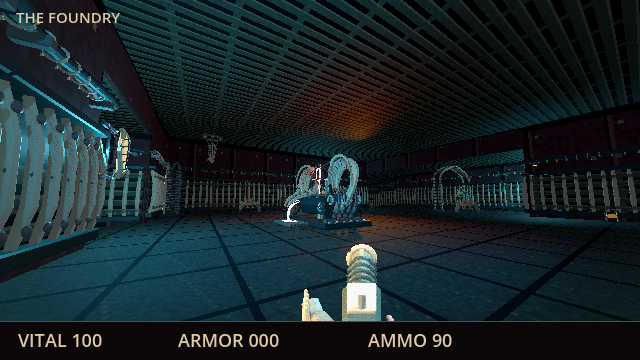
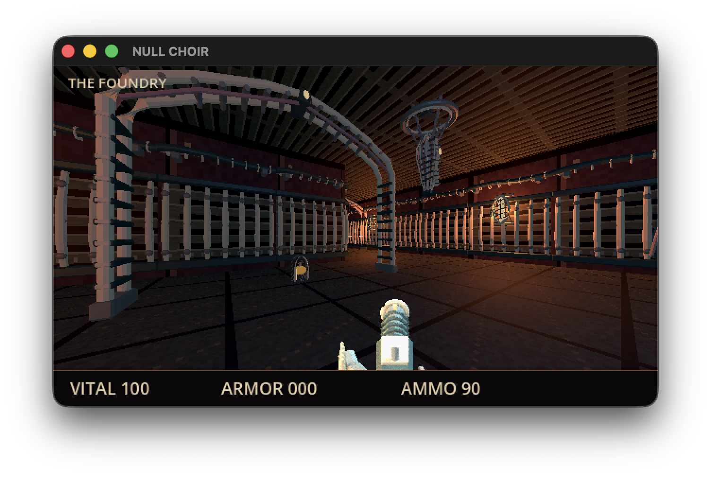

# Foundry scenery and traversal

Foundry is the second authored campaign map. Its two returning routes surround separate original Blender machines: a tall open-thorax vertebral furnace and a broad split-pelvic marrow crucible. Both retain editable sources, incised tissue textures, gauges, teeth, manifolds and mechanical supports. Together their runtime GLBs occupy 4,093,296 bytes, with seven material groups per piece. [ART.md](ART.md) owns regeneration and provenance.

## Native rendered views

These actual 640×360 Godot GPU captures use controlled camera positions and frozen actors. They demonstrate the scene's lighting and assets, not completed combat playthroughs.







The map includes 52 authored supporting placements, shared ribbed boundaries/conduits, 27 lights and four shadowed landmark spots. Native scene checks verify inward fronts, physical lamp mounting, ceiling clearance, local lit floor meshes and conservative wall-only occlusion. Raised crucible circulation has two ramps; actual native capsule traversal completes both closed loops without jumping or falling.

## Exported Mac app

The actual arm64 0.1.2 app passes controlled save/Continue, native E exit, the intermission's Descend button and the correct Foundry entry. Pause/save-to-title/Continue, short firing input (ammo 90→89) and level restart (ammo restored to 90) pass at the current window size. The screenshot below is a native capture of that dedicated window, not the source renderer. Original save bytes and preferences absence were exactly restored after quitting only the new validation app; an existing older game process was left untouched.



A native read of the final pack proves exact SHA-256 parity for 33 shipped raw data/MIDI/font resources and imported art caches. Strict ad-hoc signature, arm64-only/system dependency and offline packaged scene/art/live-MIDI checks pass. This remains an unnotarized development build.

## Gameplay evidence

Native player input completes Intake and opens the Foundry intermission. The actual player callback cannot overwrite the next entry position after exiting. Resources and discoveries persist; per-level keys and removed entities reset. Foundry's hidden casting ledger is reachable through native interaction, both seals open its exit gate, and its automatic checkpoint, death restoration, saved Continue and level restart pass.

Two Intake enemies originally saw the spawn immediately, causing 90 damage in a ten-second Merciful fixture. Moving only those authored placements behind the first junction removes entry damage without changing AI or difficulty scaling. Both maps now pass ten-second idle entry on all three modes, and moving into their central encounter still alerts enemies.

An initial limited M4 source-GPU sample measured approximately 119 FPS at entry, 106 at the furnace, 102 at the crucible and 89 during controlled native combat. Warm source build was 137 ms. The final scene rerun measured 118/105/102/98 FPS; its cloud-backed source load took 33.1 seconds. That source-I/O outlier is retained, rather than hidden with a custom cache or global cloud change. The combat fixture uses native physics/AI/firing with controlled survival and input. These samples do not establish full-campaign performance or packaged cold-start targets.

Regenerate scene evidence with:

```sh
godot --path game --script tests/test_scenery_view.gd -- --level=1 --scenery-output=/absolute/output/path
godot --headless --audio-driver CoreAudio --fixed-fps 60 --path game --quit-after 20000 --script tests/test_traversal.gd -- --level=1
godot --headless --audio-driver CoreAudio --path game --script tests/test_scenery.gd -- --level=1
```

[CHECKPOINT.md](../CHECKPOINT.md) owns current remaining campaign, validation and private-delivery gates.
