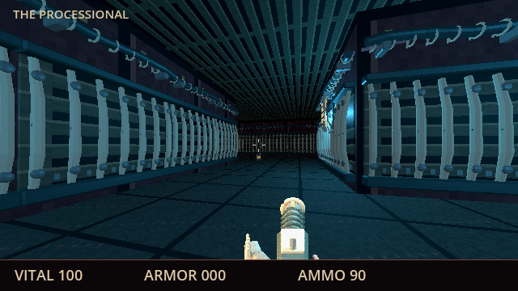
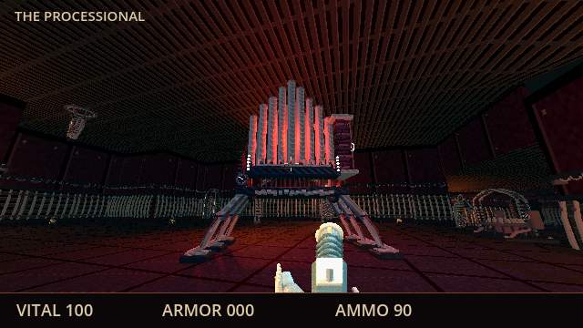
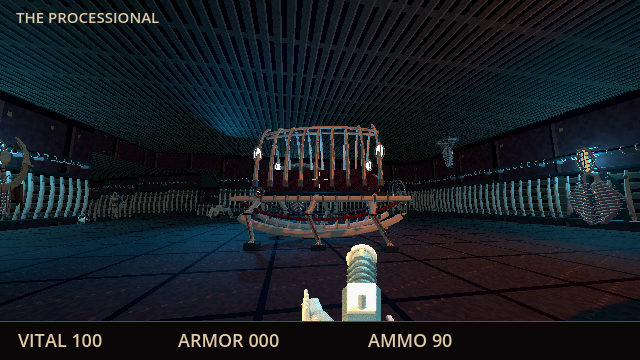
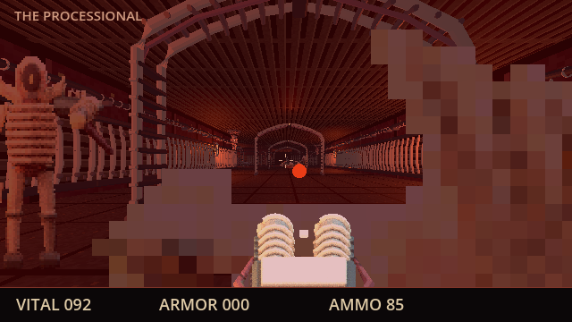
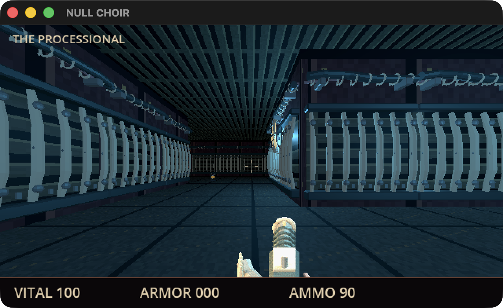

# Processional scenery and combat

The third map has two returning routes through raised organ and palanquin chambers. Each has a unique original Blender landmark. Four ramps connect the chambers without mandatory jumping; two seals open the northern exit, one optional score contradicts the recovery orders, and a checkpoint preserves earned resources.

## Native rendered views

These are actual 640×360 Godot GPU captures, with controlled camera positions and frozen actors for the three scenery views. The combat sample runs native AI, physics and firing with controlled survival. They are not full combat playthroughs.









There are 57 authored supporting placements and 28 lights, including four shadowed landmark spotlights. Shared ribbed boundaries and conduits dress the circulation routes. Vaults, mounted reliefs and lamps, suspended cadavers, containment cages and drain altars furnish the chambers. Native checks verify inward wall fronts, physical lamp mounting, ceiling clearance, local lit floors and conservative wall-only occlusion. Actual capsule traversal completes both loops and ramps without jumping or falling.

Limited M4 GPU samples measured 119/116/112 FPS at entry/organ/palanquin and 93 FPS during controlled combat. The warm source build took 125 ms; an earlier cloud-backed source load took 25.8 seconds. Neither proves the full-campaign frame-rate or packaged cold-start/transition targets. No custom cache or global cloud-setting change was added.

## Combat and campaign evidence

The entry pickup introduces the original double-barrel scattergun through the existing seven-pellet weapon profile. Caster sprites have eight directions and five distinct poses. Casters hover above native collision and launch glowing finite-lifetime projectiles; swept segment collision handles thin walls, players and enemies without tunneling. Native checks cover flight before damage, one-hit removal, infighting, fixed difficulty scaling, pause, expired flight, destroyed participants and map/resource cleanup.

The actual JSON pickup exposed floating-point weapon IDs in the inventory. One integer conversion in the shared pickup branch fixes ownership checks, selection and persistence. The original failing assertion remains; the narrow regression now parses real JSON.

Native E input completes Foundry and descends into Processional at its own spawn. The real third-map pickup, optional clue interaction, both seals, automatic checkpoint, death restoration, saved Continue and entry restart pass. Each map's entry contract remains damage-free for ten simulated seconds on all three fixed difficulties.

## Exported Mac app



The 0.1.3 Apple Silicon app passes native E exit/intermission/descent, pause/save-title/Continue, actual scattergun pickup and one-click fire (16→15 shells), persisted inventory, death restoration and restart to the original pistol/90 rivets. Window-bounded captures use the current 1280×784 size. A temporary HOME isolates campaign/preferences; the user's files and two older running games remain untouched.

These GUI paths use controlled saves. The first active-hostile pickup fixture died during operator delay; its death/restoration evidence is retained. The revised GUI-only fixture removes hostile IDs to check controls and persistence without changing production AI or granting invulnerability. Full combat pacing remains unaccepted.

Thirty-nine packed data/art/MIDI/SoundFont/notices resources match exact source/import SHA-256 hashes. Strict ad-hoc signing, arm64-only/system dependencies and offline live MIDI across all three scenes pass. This is an unnotarized development build. [CHECKPOINT.md](../CHECKPOINT.md) owns current private delivery and remaining campaign gates.

```sh
godot --path game --script tests/test_scenery_view.gd -- --level=2 --scenery-output=/absolute/output/path
godot --headless --audio-driver CoreAudio --fixed-fps 60 --path game --quit-after 20000 --script tests/test_traversal.gd -- --level=2
godot --headless --audio-driver CoreAudio --path game --script tests/test_combat_expansion.gd
godot --headless --audio-driver CoreAudio --path game --script tests/test_processional_flow.gd
```
