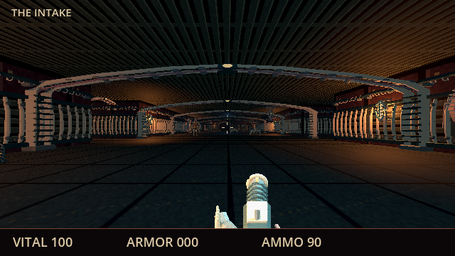
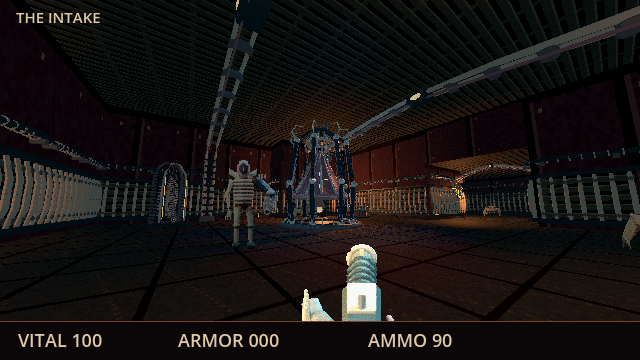
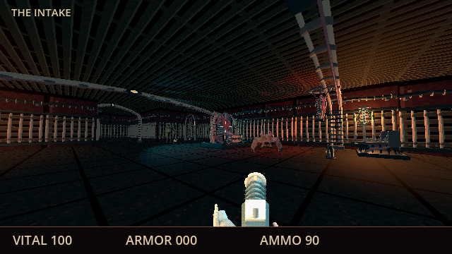
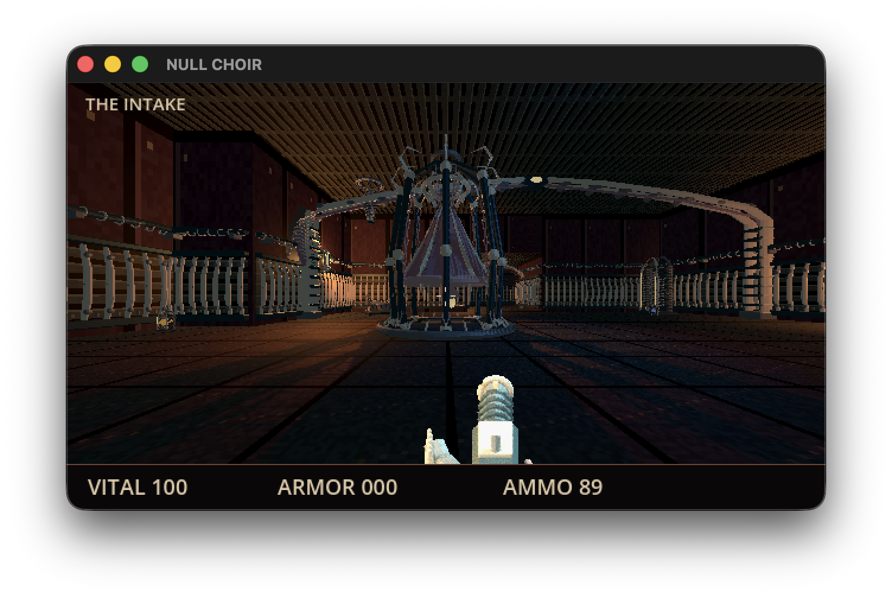
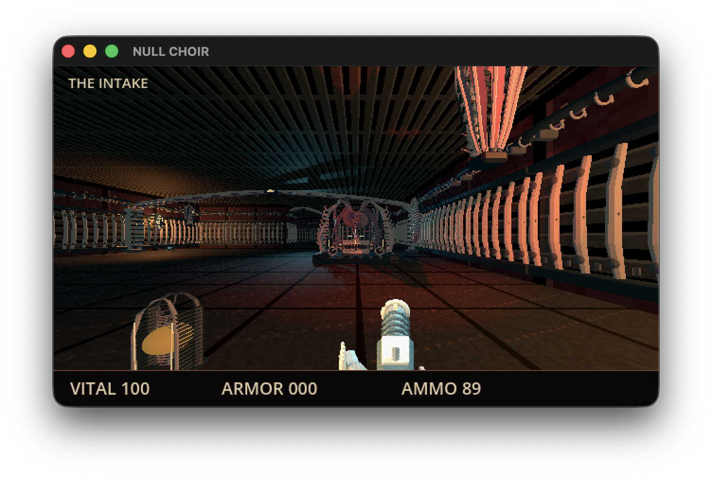

# Intake scenery and lighting

The Oct 2 correction replaces bare passages with original Blender wall ribs, conduits, vault spans, suspended anatomy, witness reliefs, containment capsules, drain altars and physical lamps. The Skin Bell and Siphon Heart retain distinct loop identities and now have detailed crowns, anatomy and machinery. [ART.md](ART.md) owns editable Blender sources and verified export provenance.

## Rendered views

These are actual Godot GPU captures at controlled camera positions, using the shipping scene, assets and Compatibility renderer at the native 640×360 viewport. Enemy movement is frozen in these three views; they are not finished-campaign playthrough evidence.







## Exported Mac app

The final arm64 0.1.1 application also renders these settings through its actual save/Continue path. These window-bounded native captures use controlled valid saves with cleared hostiles so the scenery can be inspected; they do not claim a completed playthrough. Original save bytes and settings absence were exactly restored after quitting the validation app.





[Packaged entrance capture](screenshots/app-entrance.png) confirms the lit floor and ceiling in the exported app.

## Repairs and checks

Clockwise front-face winding makes the textured floor and ceiling visible from the playable side. Local floor/ceiling chunks receive nearby lighting rather than sharing one map-wide light selection. Wall fronts face inward; sconces are backed by actual walls; spotlights stay below the ceiling. Four shadowed landmark lights, supporting amber lamps and blue/cold fill retain readable surfaces and dark recesses. Enemy sprites now receive scene lighting. Pickups and interaction markers reuse small Blender containment cages with color-coded fluid cores instead of placeholder cubes. Native capsule checks traverse both loops and their ramps; supporting machinery and landmark bases retain collision.

Native [Godot occlusion](https://docs.godotengine.org/en/stable/tutorials/3d/occlusion_culling.html) uses conservative box shapes entirely inside existing opaque static walls. Moving doors and invisible collision envelopes do not occlude. No scenery, lighting or view distance was removed to obtain the gain.

On an Apple M4, three serial control/treatment pairs gave controlled-combat medians of 61.7 FPS without occlusion and 115.5 FPS with it. All nine static view comparisons were byte-identical. Treatment entrance samples were 89.8–101.8 FPS; Bell and Siphon were approximately 118 FPS. The combat fixture executes native physics, AI and held firing with controlled survival/input. After the collectible-pod cleanup, a further native sample gave 96.4 FPS at entrance and 118.7 FPS in controlled combat. This is limited source-GPU evidence, not full-campaign performance acceptance.

Regenerate views with:

```sh
godot --path game --script res://tests/test_scenery_view.gd -- --scenery-output=/absolute/output/path
```

Run the scene contract with `python3 tools/check_game.py tests/test_scenery.gd`. Cold packaged startup, actual exported-app GUI checks and delivery state are recorded in [CHECKPOINT.md](../CHECKPOINT.md), rather than inferred from source rendering. Cloud-backed source I/O had one 28.4-second level-load outlier; warm source builds were 111–122 ms. No custom cache or global cloud setting was added to hide it.
